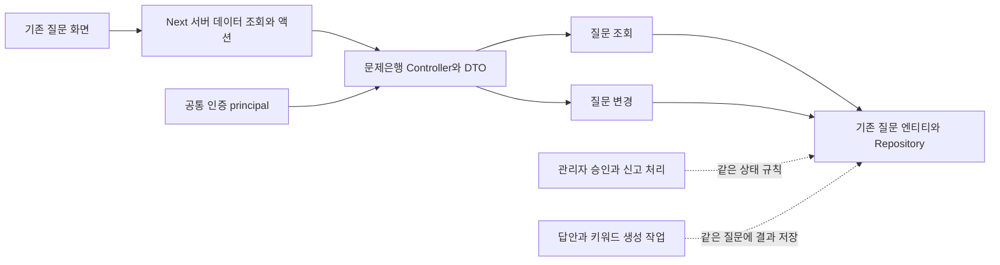
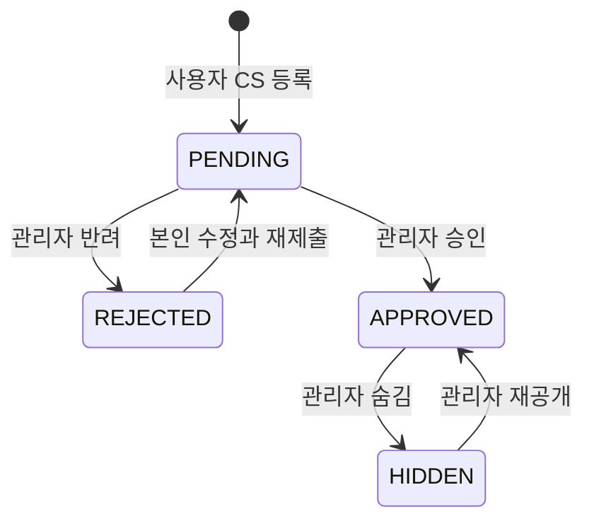

# 문제은행 백엔드 구현 청사진

WBS 3의 `problem-bank-101`부터 `problem-bank-109`까지 9개 API를 구현해 기존 질문 아카이브 화면에 연결한다. 기존 질문 엔티티를 재사용하고, 검색·페이지 조회·소유권·상태 전이·좋아요·신고 규칙을 백엔드에서 보장한다.

이 문서는 문제은행의 구현 계획이다. 확정 계약은 [공통 계약](contracts.md), [카테고리 조회](categories.md), [질문 목록](list.md), [질문 상세](detail.md), [사용자 등록](create.md), [수정·재제출](update.md), [본인 질문 삭제](delete.md), [좋아요 등록·취소](likes.md), [질문 신고](reports.md)에 기록한다. 프론트의 [조회 연결](../../frontend/question/archive.md)과 [변경 액션 연결](../../frontend/question/actions.md)은 화면 문서에서 다루며, 연결 검증의 범위와 남은 조건은 [통합 회귀 검증](integration-regression.md)에 기록한다.

관리자용 질문 CRUD·승인/반려·신고 처리의 요구사항과 AQB-01~AQB-12 작업 순서는 [관리자 문제은행 청사진](admin.md)에 둔다. 화면 연결은 [관리자 문제은행 화면](../../frontend/question/admin.md)을 따른다. 사용자 문제은행과 기존 모델·카테고리·공개 조건·행 잠금을 공유한다.

## 1. 요구사항과 범위

원본은 [최종프로젝트 4팀 WBS의 WBS 3](https://docs.google.com/spreadsheets/d/1ZcudXgHfxo-pvC2YsAEQAIcAnhHKStIwND0lUe540Ig/edit?gid=204813250#gid=204813250)이다. 문제은행은 `A14:N23`, 인증은 `auth-103`, 연계 작업은 `my-105`·`my-106`·`my-114`와 `admin-101`~`admin-104`·`admin-107`~`admin-109`를 참고한다. `admin-105/106`은 회원 관리 범위다.

| WBS | 메서드·경로 | 보장할 동작 |
| --- | --- | --- |
| problem-bank-101 | `GET /api/v1/learning/questions` | 공개 질문 목록, 검색·대분류·카테고리·좋아요 필터, 정렬, 서버 페이지 조회, 전체 건수·대분류 건수 |
| problem-bank-102 | `GET /api/v1/learning/questions/{questionId}` | 공개 질문 상세 또는 본인의 미승인 USER 질문 상세, 답안·키워드·개인별 상태·수정/삭제 가능 여부 |
| problem-bank-103 | `POST /api/v1/learning/questions/{questionId}/likes` | 인증 회원의 공개 질문 좋아요 등록, 변경 후 건수·선택 상태 |
| problem-bank-104 | `DELETE /api/v1/learning/questions/{questionId}/likes` | 본인의 좋아요 취소, 변경 후 건수·선택 상태 |
| problem-bank-105 | `GET /api/v1/categories` | CS/인성 대분류, 카테고리 ID·이름·표시 순서·공개 질문 수 |
| problem-bank-106 | `POST /api/v1/learning/questions` | 사용자 CS 질문을 본인 소유의 `USER/PENDING`으로 등록하고 생성 ID 반환 |
| problem-bank-107 | `PATCH /api/v1/learning/questions/{questionId}` | 본인 `PENDING/REJECTED` CS 질문 수정, 반려 질문은 검토 정보 초기화 후 재제출 |
| problem-bank-108 | `DELETE /api/v1/learning/questions/{questionId}` | 본인 `PENDING/REJECTED` 질문의 `deleted_at` 반영 |
| problem-bank-109 | `POST /api/v1/learning/questions/{questionId}/reports` | 공개 질문 신고, 필수 5유형 사유와 선택 상세 사유 검증 |

### 다른 작업과의 연결

- 관리자 등록·수정·승인·반려·숨김·신고 처리는 [관리자 청사진](admin.md)의 별도 작업이다. 이번 사용자용 9개 API가 관리자용 7개 API를 대신 구현하지 않는다.
- 승인 후 AI 답안 생성은 관리자·AI 담당 작업이다. 질문 ID, 답안 상태, 답안 본문과 키워드를 같은 질문에 기록하는 계약을 공유한다.
- 내가 올린 질문 목록은 `my-114`, 좋아요한 질문 목록과 대시보드 집계는 `my-106`·`my-105`와 연결한다. 문제은행의 공개 목록에 본인 미승인 질문을 섞지 않는다.
- 면접에서 생성된 질문의 개인 좋아요는 별도 관계다. 문제은행의 `question_likes`와 합치지 않는다.
- 프론트 URL은 현재 `/archive`와 `/archive/{id}`를 유지한다. WBS에 적힌 `/study/questions`로 화면 URL을 옮기는 작업은 이번 연결에 포함하지 않는다.

## 2. 기반과 연계 조건

기존 질문 엔티티와 인증 구현을 재사용한다. 문제은행 API와 프론트의 책임, 담당 간 연계 조건은 다음과 같다.

| 영역 | 기반과 책임 | 연계 조건 |
| --- | --- | --- |
| 백엔드 | Java 21, Spring Boot 4.2.0, JPA·Validation·WebMVC, H2, 질문 Repository·Service·Controller와 DTO | 운영 DB/migration 연계 |
| 질문 데이터 | `Question`, `Category`, `QuestionKeyword`, `QuestionLike`, `QuestionReport`, `QuestionModeration` | 기존 모델 활용, 필요한 불변식·경합 처리 보강 |
| 공통 기반 | 문제은행 오류 응답, JWT 검증 후 DB 회원 기반 principal, 공개·소유권 정책 | 실제 카카오 설정·계정 확인, 운영 DB/migration 연계 |
| 카테고리 | 조회·공개 건수·초기 분류와 프론트 분류 ID 연결 | 운영 seed/migration 정책 연계 |
| 질문 목록 | 검색·분류·좋아요 필터, 정렬·서버 페이지·집계를 프론트에 연결 | 실제 계정 전체 흐름 검증(QB-12) |
| 질문 상세 | 공개·본인 미승인 조회, 반려·답안 상태·권한·앞뒤 질문을 화면에 연결 | 실제 계정 전체 흐름 검증(QB-12) |
| 사용자 등록 | CS 분류 ID로 등록, 생성 ID로 승인대기 상세 이동 | 실제 계정 전체 흐름 검증(QB-12) |
| 수정·재제출 | PATCH 연결, 본인 미승인 수정·검토 정보 초기화와 상세 갱신 | 관리자 쓰기의 동일 잠금 규칙 연계 |
| 본인 질문 삭제 | DELETE 연결, 기록 보존, 성공 후 관련 화면 갱신과 이동 | 관리자 쓰기의 동일 잠금 규칙 연계 |
| 좋아요 등록·취소 | POST/DELETE 연결, 서버 최종 집계와 개인 선택 상태 반영 | 관리자 쓰기의 동일 잠금 규칙 연계 |
| 질문 신고 | 5유형 코드 변환과 상세 검증, 업무 오류 안내·신고 상태 갱신 | 관리자 신고 처리·공통 잠금 및 운영 DB 연계 |
| 프론트 통신 | Next 서버가 Bearer 토큰을 붙여 WBS 경로·메서드·DTO로 `BACKEND_URL` 호출 | 실제 계정 브라우저 전체 흐름 검증(QB-12) |
| 프론트 목록/상세 | 서버 페이지 응답과 전용 상세 조회 사용, 변경 액션 연결, 개인 전체 배열 소비자 분리 | 개인 API 연결, 관리자·AI 전체 흐름 검증(QB-12) |

주요 근거: [빌드 설정](../../../backend/build.gradle), [질문 엔티티](../../../backend/src/main/java/com/likelion/answerfit/question/entity/Question.java), [프론트 호출](../../../frontend/features/question/api.ts), [화면 자료형](../../../frontend/features/question/types.ts), [목록 데이터 조립](../../../frontend/app/(site)/archive/page.tsx), [상세 데이터 조립](../../../frontend/app/(site)/archive/[id]/page.tsx).

개인 전체 목록과 면접 결과 질문 좋아요의 `/api/v1/questions` 계약은 각 담당 API와 연결한다. 아카이브 조회는 QB-10의 서버 페이지와 반려 상태 계약을, 문제은행 변경 액션은 QB-11의 `/api/v1/learning/questions`, `PATCH /{id}`, `POST/DELETE /{id}/likes` 계약을 따른다.

## 3. 모듈과 책임



- `question/entity`: 현재 모델과 상태 전이를 유지한다. 소유권을 HTTP 요청 값에서 받지 않는다.
- `question/repository`: 공개 조건·검색·정렬·집계·개인별 좋아요/신고 여부 조회를 담당한다.
- `question/service`: 조회와 변경을 구분한다. 변경 트랜잭션 안에서 소유권·현재 상태·카테고리를 검사하고 기존 엔티티 메서드를 호출한다.
- `question/controller`와 DTO: WBS 경로, 입력 검사, 응답 투영을 담당한다. JPA 엔티티를 직접 JSON으로 노출하지 않는다.
- 공통 인증과 업무 오류는 다른 도메인도 쓸 수 있게 공유한다. 구현이 하나뿐인 로직에 불필요한 interface/implementation 쌍을 만들지 않는다.

조회·변경·카테고리의 공개 판정은 한 규칙으로 모은다. 목록, 상세, 집계, 좋아요, 신고에서 같은 질문이 서로 다르게 공개되지 않도록 한다.

## 4. 데이터와 상태 규칙

### 기존 데이터 구조 재사용

| 모델 | 이번 작업에서의 역할 |
| --- | --- |
| `categories` | `major`, `name`, `sort_order`로 분류와 표시 순서 제공 |
| `questions` | 분류·내용·출처·작성자·승인/검토·답안 생성 상태와 soft delete |
| `question_keywords` | 질문별 키워드와 순서 보존 |
| `question_likes` | `(user_id, question_id)` 복합 PK로 회원별 좋아요 하나 보장 |
| `question_reports` | `(question_id, reporter_id)` 유일 제약과 신고 처리 상태 보존 |
| `question_moderations` | 반려/신고 조치 이력. 재제출할 때 과거 이력은 삭제하지 않음 |

새 질문 테이블은 만들지 않는다. 엔티티 주석에 적힌 복합 FK 등의 제약은 실제 DDL 적용 여부를 따로 확인한다. 운영 DB와 migration 방식이 정해지기 전에는 H2에서 통과한 결과를 운영 DB 검증으로 간주하지 않는다.

### 공개·소유권·변경 규칙 제안

- 공개 질문: `deleted_at IS NULL AND status=APPROVED`. 여기서 공개는 질문의 가시성이고 익명 접근 허용 여부와는 별개다.
- 승인 직후 답안이 생성 중이거나 생성에 실패해도 질문은 공개한다. 기존 화면 동작처럼 `modelAnswerStatus`와 nullable 답안으로 이를 구분한다. 면접 출제에 답안이 필요한 조건은 면접 담당이 별도로 적용한다.
- 미승인 상세: 인증된 본인의 `source=USER`이면서 `PENDING/REJECTED`인 질문만 허용한다. 타인의 미승인 질문, 숨김·삭제 질문은 상세에서 `404`로 처리한다.
- 수정·삭제: `source=USER`, `author_id=인증 회원`, `status IN (PENDING, REJECTED)`를 모두 만족해야 한다. `isMine`과 별도로 `canEdit/canDelete`를 응답한다.
- `REJECTED` 수정은 같은 ID로 `PENDING` 재제출이다. `reviewedBy/reviewedAt`을 비우고 현재 반려 안내를 해제하되 과거 `QuestionModeration`은 남긴다.
- 삭제는 `Question.delete()`로 `deleted_at`을 설정한다. 현재 `@SQLRestriction`만 있으므로 `repository.delete()`를 soft delete로 가정하지 않는다.
- 숨김·삭제는 과거 면접의 질문 스냅샷, 기존 신고와 검토 이력을 지우지 않는다.



답안 상태는 위 승인 상태와 독립적이다. 관리자 직접 작성은 `modelAnswerStatus=null`, 사용자 질문 승인 시 `PENDING`, 생성 성공 시 `DONE`, 실패 시 `FAILED`다. 위 흐름의 관리자·AI 처리는 연계 계약이며 이번 API 구현 범위가 아니다. 특히 현재 `Question`에는 재공개 메서드가 없으므로 `HIDDEN → APPROVED`는 관리자 작업에서 추가할 전이다.

### 입력과 반복 요청

- 사용자 등록은 CS만 허용한다. 요청에서는 `categoryId/content`만 받고, `major=CS`, `source=USER`, 작성자와 초기 상태는 서버가 설정한다.
- 카테고리는 실제 존재하는 CS 분류여야 한다. 수정에서도 대분류 불일치를 허용하지 않는다.
- 질문은 trim 후 최대 200자다. 기존 화면의 최소 10자도 유지하는 안을 제안한다. 프론트와 동일하게 Unicode code point 기준을 사용한다.
- 신고 상세는 trim 후 최대 300 code point이며 빈 값은 허용한다. 300개 이모지 저장을 위해 DB 컬럼은 600단위를 확보한다. 이유와 운영 DB 변경은 [질문 신고](reports.md)에 기록한다.
- 신고 유형은 `WRONG_QUESTION`, `WRONG_ANSWER`, `DUPLICATE`, `INAPPROPRIATE`, `ETC`다. 기존 enum 값은 유지하고 질문 내용 오류용 `WRONG_QUESTION`을 추가했다. 상세 계약과 화면 문구 매핑은 [질문 신고](reports.md)를 따른다.
- 본인 질문 신고는 거절한다. 기존 유일 제약에 맞춰 한 회원이 같은 질문을 다시 신고하면 `409 ALREADY_REPORTED`를 반환한다. 관리자 신고 종료 후에도 재신고를 허용하지 않는다.
- 좋아요 POST는 이미 등록되어 있어도 같은 최종 상태, DELETE는 좋아요가 없어도 취소된 최종 상태를 반환한다. 중복·동시 요청에도 한 행과 정확한 집계를 보장한다.
- 목업의 승인대기 질문 10개 제한은 WBS의 확정 요구가 아니다. 별도 합의 전에는 이 제한을 백엔드 정책으로 추가하지 않는다.

## 5. HTTP 계약 초안

### 공통 형식과 인증

- 성공 응답은 별도 envelope 없이 JSON 객체를 반환한다. ID는 DB에서 `Long`, JSON에서는 문자열로 전달하는 안을 제안한다. 시각은 ISO 8601 UTC로 전달하고 화면 날짜는 KST로 변환한다.
- 현재 질문 화면의 로그인 요구를 유지한다. 익명 조회 허용 여부는 인증 담당과 별도 확정하며, 허용하더라도 개인화 필드와 `likedOnly`는 인증이 필요하다.
- 사용자 식별은 공통 인증에서 검증한 principal의 ID·권한·계정 상태를 사용한다. 임의의 `userId` body/query나 신뢰할 수 없는 별도 헤더로 대체하지 않는다.
- 쓰기 요청은 미인증·만료 토큰을 `401`, 이용 정지 등 접근 거절을 `403`으로 처리한다. 읽기도 전달된 잘못된 토큰을 조용히 익명으로 바꾸지 않는다.
- 오류는 프론트가 읽을 수 있는 `{code, message}`를 기본으로 하고, 필요하면 입력별 `fieldErrors`를 추가한다. 업무상 404에도 `code`를 넣어 “API 미연동”으로 오인되지 않게 한다.

```json
{
  "code": "QUESTION_NOT_FOUND",
  "message": "질문을 찾을 수 없습니다."
}
```

### 목록과 카테고리

목록의 확정된 요청·응답과 경계값은 [질문 목록 조회](list.md)를 따른다.

목록 요청 예: `GET /api/v1/learning/questions?major=CS&categoryId=1&keyword=프로세스&likedOnly=false&sort=LATEST&page=1&pageSize=7`.

| 쿼리 | 제안 계약 |
| --- | --- |
| `major` | 생략 시 `CS`, `CS/PERSONALITY`만 허용 |
| `categoryId` | 생략 가능. 존재 여부와 선택 대분류 일치 검사 |
| `keyword` | trim 후 최대 100자, 질문 본문 검색. 대소문자·공백 정규화는 기존 검색 의미를 유지하고 LIKE 특수문자는 문자로 처리 |
| `likedOnly` | 기본 `false`, `true`면 현재 회원 좋아요만 조회 |
| `sort` | `LATEST`: `createdAt DESC, id DESC`; `LIKES`: `likeCount DESC, createdAt DESC, id DESC` |
| `page` | 1부터 시작. 음수·0·비정수는 `400` |
| `pageSize` | 기본 7, 1~100의 정수. 화면에서 요청한 유효한 크기를 그대로 적용 |

응답 필드는 `items`, `totalCount`, `page`, `pageSize`, `totalPages`, `majorCounts`다. `majorCounts`는 `{"CS":0,"PERSONALITY":0}` 형태의 대분류별 건수다. `items`에는 `id/major/category/content/status/likeCount/isLiked/isMine/isReported`를 포함한다. 목록에는 답안 본문·키워드 전체를 싣지 않는다.

`totalCount`는 모든 검색·분류·좋아요 조건을 적용한 건수다. 현재 화면처럼 탭 건수는 필터와 무관한 공개 전체 건수로 유지한다. 따라서 `majorCounts`는 전체 공개 질문의 CS/인성별 건수이고, 카테고리 API의 `questionCount`도 해당 카테고리 전체 공개 건수다. 필터에 따라 건수가 바뀌는 정책으로 바꾸려면 이 의미부터 함께 변경한다.

요청 페이지가 마지막 페이지를 넘으면 마지막 유효 페이지로 보정해 실제 `page`를 반환한다. 결과가 없으면 `items=[]`, `totalCount=0`, `page=1`, `totalPages=1`로 현재 페이지 UI와 맞춘다. 페이지 사이에 데이터가 변경되면 offset 방식상 순서가 달라질 수 있으며, 동점 정렬에는 ID를 사용한다.

카테고리 응답은 `majors:[{major,name,questionCount,categories:[{id,name,sortOrder,questionCount}]}]`로 제안한다. 질문이 0개인 카테고리도 반환하며 `sortOrder,id` 순서로 정렬한다. CS 6개 카테고리와 인성 분류의 초기 값·ID는 관리자/면접 담당과 공유하고 DB seed로 관리한다.

### 상세

확정된 접근 권한과 응답은 [질문 상세 조회](detail.md)를 따른다.

`GET /api/v1/learning/questions/{questionId}`는 목록 포함 여부와 무관하게 질문을 직접 조회한다. 다음 값을 반환한다.

- 기본: `id`, `major`, `category`(`id/name`, 없으면 `null`), `content`, `source`, `status`, `createdAt`, `reviewedAt`.
- 개인화: `likeCount`, `isLiked`, `isMine`, `isReported`, `canEdit`, `canDelete`, `canReport`.
- 학습: `modelAnswer`(문자열 또는 `null`), `modelAnswerStatus`, `keywords`(순서대로, 없으면 빈 배열).
- 반려: 현재 `REJECTED`일 때 본인에게 보여 줄 `rejectionReason`. 재제출 후에는 `null`이며 이전 조치 이력은 남는다.
- 앞뒤 이동: `previous/next`에 같은 대분류·카테고리의 공개 질문 `id/content`, 없으면 `null`. 기본 최신순을 사용하며 미승인 상세에서는 둘 다 `null`로 반환한다.

승인 상태와 답안 상태를 함께 제공해 미승인·생성 중·생성 실패·답안 존재를 구별한다. 상세 GET은 AI 생성이나 재생성을 실행하지 않는다.

### 등록·수정·삭제·좋아요·신고

등록은 [사용자 질문 등록](create.md), 수정과 재제출은 [수정·재제출](update.md), 삭제는 [본인 질문 삭제](delete.md), 좋아요는 [좋아요 등록·취소](likes.md), 신고는 [질문 신고](reports.md)의 확정 계약을 따른다.

| 작업 | 요청 | 성공 응답 제안 |
| --- | --- | --- |
| 질문 등록 | `{categoryId, content}` | `201`, `Location` 헤더와 `{id,status:"PENDING"}` |
| 질문 수정 | 변경할 `categoryId/content` 중 하나 이상. 최종 상태의 분류·내용 검증 | `200`, `{id,status,canEdit,canDelete}` |
| 질문 삭제 | 본문 없음 | `204`, 이후 상세는 `404` |
| 좋아요 등록/취소 | 본문 없음 | `200`, `{likeCount,isLiked}` |
| 신고 등록 | `{reasonType,detail}` | `201`, `{id,status:"PENDING"}` |

등록·신고 POST는 생성 요청이므로 무조건 자동 재시도하지 않는다. 질문 생성의 중복 방지 키가 필요하면 별도 계약으로 추가한다. 좋아요는 반복 가능한 상태 설정으로 처리한다. 이미 삭제된 질문의 DELETE는 `404`여도 데이터 상태는 그대로다.

### 오류 구분 제안

| HTTP | 예시 code | 의미 |
| --- | --- | --- |
| 400 | `INVALID_REQUEST`, `INVALID_CATEGORY`, `INVALID_REPORT_REASON` | 입력·페이지·enum·분류 검증 실패 |
| 401 | `UNAUTHENTICATED` | 인증이 없거나 토큰이 유효하지 않음 |
| 403 | `ACCESS_DENIED`, `SELF_REPORT_NOT_ALLOWED` | 계정/권한 거절 또는 본인 질문 신고 |
| 404 | `QUESTION_NOT_FOUND` | 없음·삭제·숨김·접근할 수 없는 미승인 질문 |
| 409 | `QUESTION_NOT_EDITABLE`, `ALREADY_REPORTED`, `QUESTION_STATE_CHANGED` | 승인 등으로 변경 불가, 중복 신고, 경합 중 상태 변경 |

상세를 볼 수 있는 본인의 승인 질문 수정/삭제는 `409`, 타인의 미승인 질문 접근은 `404`로 구분한다. DB 유일 제약 충돌을 그대로 `500`으로 내보내지 않는다.

## 6. 기존 프론트 연결 계획

연결을 위한 데이터 처리 변경은 필요하다. 새로운 화면 디자인을 만드는 작업은 포함하지 않는다.

| 연결 지점 | 필요한 변경 |
| --- | --- |
| `features/question/api.ts` | WBS 경로·메서드로 전환. 목록과 상세를 분리하고 쿼리를 전달. 전체 배열에서 질문을 찾는 사전 권한 검사를 서버 결과에 맞춤 |
| `features/question/types.ts`와 변환 | `CS/PERSONALITY ↔ cs/personality`, `content ↔ text`, `likeCount/isLiked/isMine ↔ likes/liked/mine`, 카테고리 ID와 표시 이름 매핑 |
| `/archive` 데이터 조회부 | 서버의 `items/totalCount/page/totalPages/majorCounts` 사용. 응답에 로컬 검색·페이지 나누기를 다시 적용하지 않음 |
| `/archive/{id}` 데이터 조회부 | 전용 상세 요청과 `previous/next` 사용. 공개 목록에 없는 본인 미승인 질문도 열 수 있어야 함 |
| 반려 상태 | `REJECTED`를 독립적으로 표현하고 사유·재제출·수정/삭제 권한을 연결. 대기나 승인으로 오표시하지 않음 |
| 등록 폼·서버 액션 | 생성 ID를 버리지 않고 승인대기 상세 링크 또는 이동으로 연결 |
| 분류 선택 | 카테고리 API의 ID·이름을 사용. 한글 이름 상수만으로 저장 요청을 만들지 않음. 인성 질문의 중분류가 없으면 대분류 이름으로 표시하고 중분류 링크/칩은 생략 |
| 신고 폼 | 기존 5개 문구와 `reasonType`을 일대일 매핑. 중복/본인 신고 실패 안내 |
| 모범답안 표시 | 기존 목업과 같이 첫 문단을 `summary`, 나머지를 `body`로 변환하고 키워드 연결. 저장되지 않은 비교표를 만들지 않음 |

반려 안내와 답안 생성 실패의 정확한 구분에는 기존 컴포넌트의 조건부 표시 보강이 필요하다. 이 변경도 스타일 재설계가 아닌 실제 상태 연결로 다룬다.

### 전체 배열을 공유하는 화면의 회귀 방지

기존 `getQuestions()`의 소비자를 아카이브 조회와 `/my/questions`, `/my/likes`, `/my` 대시보드의 개인 조회로 분리했다. 공개 질문 첫 페이지로 개인 전체 데이터를 대체하면 본인 미승인 질문·좋아요 목록·건수가 누락되므로 각 전용 계약을 유지한다.

- `my-114`는 내 질문과 상태별 건수의 전용 계약을 사용한다. 문제은행 상세·수정·삭제는 이번 계약을 재사용한다.
- `my-106`·`my-105`는 좋아요 목록과 전체 건수를 제공한다. 공개 목록 첫 페이지를 세어 대체하지 않는다.
- 회원 담당이 이 API들을 연결하기 전까지 해당 화면 전체의 백엔드 연결 완료로 보고하지 않는다. 분리한 개인 조회의 미연결 오류를 공개 목록이나 빈 배열로 감추지 않는다.

유사 질문은 별도 생성 API를 추가하지 않고 기존 질문 검색을 재사용한다. QB-11은 입력의 조사·일반 문구를 정리해 가장 긴 핵심어를 최대 100 code point로 추출하고 최신순 후보 한 페이지 20개를 조회한다. 그 후보에서 전체 입력 최대 200 code point의 기존 조각 유사도를 비교한다. 전체 아카이브를 반복 다운로드하지 않으며 검색 후보 밖의 유사 질문까지 보장하지 않는다. 상세 기준은 [변경 액션 연결](../../frontend/question/actions.md)을 따른다.

통신 경로는 브라우저 → Next 서버 액션/조회 → 백엔드다. 기존 `BACKEND_URL`과 Bearer 전달을 사용하고, 현재 경로만을 위해 브라우저 직접 호출용 CORS 구성을 추가하지 않는다.

## 7. 기능별 구현 순서

각 항목은 구현, 관련 테스트, 필요한 문서 수정을 함께 포함한다. 아래 번호는 작업 순서와 의존성을 식별하는 용도이며, 외부 연계가 필요한 항목은 선행 조건을 확인한다.

### 기반과 백엔드 API

- **QB-01 공통 계약과 처리 기반**

  선행: 없음. 인증 principal·계정 상태·세션 API, DB/migration·카테고리 seed 담당, 공개 조건·입력 길이·페이지·중복 신고 정책을 확정한다. 문제은행에서 사용할 요청/응답·업무 오류·입력 검증과 인증 연계 방식을 마련한다. 인증 서버·회원 API·운영 DB 구축은 각 담당과 연결한다.

  완료 기준: 이 문서의 제안 중 구현에 필요한 항목이 확정되고, 문제은행의 공통 오류 응답과 길이·분류·페이지 검증 테스트가 통과한다. 실제 인증이 아직 연결되지 않았다면 해당 연계 조건을 기록한다. 관련 시나리오: S3·S4·S9·S11.

  구현 계약과 연계 조건: [공통 계약](contracts.md).

- **QB-02 카테고리 조회**

  선행: QB-01. `problem-bank-105`의 `GET /api/v1/categories`와 분류별 공개 질문 집계를 구현한다. 합의한 seed를 적용하고 관리자·면접에서 같은 ID와 표시 순서를 재사용할 수 있게 한다.

  완료 기준: CS/인성 분류·정렬·0건 카테고리가 반환되고, 숨김·삭제·미승인 질문이 집계에서 제외된다. Repository·HTTP 검증 포함. 관련 시나리오: S1·S10.

  구현 계약과 초기화 정책: [카테고리 조회](categories.md).

- **QB-03 질문 목록·검색·필터·페이지 조회**

  선행: QB-01·QB-02. `problem-bank-101`의 목록 API를 구현한다. 대분류·카테고리·검색어·좋아요 필터, 최신/좋아요 정렬, 서버 페이지 조회와 전체·대분류 건수를 제공한다.

  완료 기준: 개인별 좋아요·본인·신고 여부와 집계가 일치하고, 페이지 크기·빈 결과·범위 초과·동점 정렬을 검증한다. 페이지별 묶음 조회로 불필요한 반복 쿼리를 방지한다. 관련 시나리오: S1·S2.

  구현 계약과 조회 정책: [질문 목록 조회](list.md).

- **QB-04 공개 질문·본인 미승인 질문 상세**

  선행: QB-01·QB-02·QB-03. `problem-bank-102`의 상세 API를 구현한다. 공개 질문과 본인 USER 대기/반려 질문을 직접 조회하고, 답안·키워드·생성 상태·반려 사유·수정/삭제 권한·앞뒤 질문을 반환한다.

  완료 기준: 본인 미승인 질문은 목록에 없어도 조회되고 타인은 404를 받는다. 숨김·삭제 질문, 중분류 없는 인성 질문, 답안 없음/생성 중/실패, 키워드 순서와 앞뒤 이동을 검증한다. 관련 시나리오: S1·S3·S10.

  구현 계약과 접근 정책: [질문 상세 조회](detail.md).

- **QB-05 사용자 CS 질문 등록**

  선행: QB-01·QB-02·QB-04. `problem-bank-106`의 등록 API를 구현한다. 카테고리와 질문을 검증하고 인증 회원 소유의 `USER/PENDING` 질문을 생성한다.

  완료 기준: 생성 ID·상태와 Location을 반환하고, 길이·공백·CS 분류·작성자/출처/상태 위조를 검증한다. 공개 목록에는 바로 포함되지 않고 생성 ID로 본인 상세를 열 수 있다. 관련 시나리오: S3·S4.

  구현 계약과 초기 상태: [사용자 질문 등록](create.md).

- **QB-06 본인 질문 수정·반려 재제출**

  선행: QB-04·QB-05. `problem-bank-107`의 PATCH를 구현한다. 본인 USER 대기/반려 질문의 분류·내용을 수정하고 반려 질문을 같은 ID로 재제출한다.

  완료 기준: 재제출 시 현재 검토 정보가 초기화되고 과거 반려 이력은 남는다. 타인·승인 질문 변경과 관리자 승인 경합을 검증한다. 관련 시나리오: S5·S6.

  구현 계약과 잠금 규칙: [수정·재제출](update.md).

- **QB-07 본인 미승인 질문 삭제**

  선행: QB-04·QB-05. `problem-bank-108`의 DELETE를 구현한다. 본인 USER 대기/반려 질문만 엔티티의 삭제 메서드로 soft delete한다.

  완료 기준: 삭제 후 상세·목록에서 제외되고, 타인/승인 질문 삭제와 승인 경합이 차단된다. 물리 삭제 없이 과거 면접 스냅샷·신고·검토 이력을 보존한다. 관련 시나리오: S6·S7.

  구현 계약과 기록 보존·잠금 규칙: [본인 질문 삭제](delete.md).

- **QB-08 좋아요 등록·취소**

  선행: QB-04. `problem-bank-103`·`problem-bank-104`의 POST/DELETE를 함께 구현한다. 공개 질문에 대한 인증 회원의 좋아요를 등록/취소하고 최종 건수·선택 상태를 반환한다.

  완료 기준: 반복·동시 요청에도 회원별 한 행을 유지한다. 다른 회원의 상태, 미승인/숨김/삭제 질문 거절과 관리자 숨김/삭제 경합을 검증한다. 관련 시나리오: S8.

  구현 계약과 반복 요청·잠금 규칙: [좋아요 등록·취소](likes.md).

- **QB-09 질문 신고와 5유형 검증**

  선행: QB-04. `problem-bank-109`의 신고 API를 구현한다. 질문 내용 오류용 enum을 추가해 5유형을 구분하고 상세 사유를 검증해 PENDING 신고를 저장한다.

  완료 기준: 빈 상세·300/301자·잘못된 사유·본인/중복 신고·비공개 질문을 검증한다. 유일 제약과 공개 상태 경합 오류를 합의한 업무 오류로 반환한다. 관련 시나리오: S9.

  구현 계약과 중복·잠금 규칙: [질문 신고](reports.md).

### 프론트 연결과 전체 검증

- **QB-10 카테고리·목록·상세 프론트 연결**

  선행: QB-02·QB-03·QB-04, 실제 인증·세션 조회 연계. API adapter·자료형·페이지 데이터 조회부를 WBS 계약에 맞춘다. 서버 페이지/집계, 전용 상세, 반려 사유·답안 상태·앞뒤 질문과 중분류 없는 인성 질문 표시를 연결한다.

  완료 기준: 실제 API 응답으로 목록/상세가 표시되고 중복 검색·페이지 나누기가 없다. 기존 `getQuestions()` 소비자를 분리해 내 질문·좋아요·대시보드가 첫 페이지 데이터로 대체되지 않게 한다. 관련 시나리오: S2·S3·S10·S12.

  조회 adapter·화면·목업 호환과 인증 통합 범위: [프론트 아카이브](../../frontend/question/archive.md). 인증 구현과 현재 DB 기반 principal을 사용하며, 실제 카카오 계정과 운영 설정의 브라우저 검증은 QB-12에서 수행한다.

- **QB-11 등록·수정·삭제·좋아요·신고 프론트 연결**

  선행: QB-05~QB-10. 기존 폼과 서버 액션을 실제 변경 API에 연결한다. 생성 ID를 상세 링크/이동으로 전달하고 카테고리 ID·신고 유형을 변환한다. 합의한 검색어 추출·후보 기준으로 기존 검색 API를 유사 질문 안내에 재사용한다.

  완료 기준: 각 동작의 성공 결과·업무 오류·재조회가 화면에 반영된다. 반려 재제출, 100자 검색어 제한, 중복 요청과 권한 거절도 확인한다. 관련 시나리오: S4·S5·S7·S8·S9·S11·S12.

  입력·분류·신고 유형 변환, 성공 후 이동·갱신과 후보 검색 기준: [프론트 변경 액션](../../frontend/question/actions.md).

- **QB-12 전체 흐름과 연계 회귀 검증**

  선행: QB-10·QB-11. 팀원이 인증/회원·관리자·AI·개인 API 개발을 완료하면 해당 결과를 통합하고 실제 전체 흐름 검증을 재개한다. 실제 인증을 사용한 개발 모드에서 S1~S12를 확인하고 발견한 연결 오류를 수정한다. 내 질문·좋아요·대시보드는 각 담당 API와 연결해 전체 데이터 누락을 확인한다.

  완료 기준: 로그인 → 목록/상세 → 좋아요 → 등록/본인 상세 → 수정/재제출/삭제 → 신고가 동작하고 관리자 승인·답안 생성 상태가 반영된다. 자동 검사와 실제 계정·담당 API를 사용한 직접 확인 결과를 남긴다. 해당 API 구현은 기존 담당 범위를 유지한다.

  검증 범위와 연계 조건: [통합 회귀 검증](integration-regression.md). 실제 HTTP·JWT·JPA와 프론트 조회/액션의 회귀 검사, 목업 브라우저 관찰, 실제 카카오 계정·관리자·AI·개인 API 통합 이후 검증을 구분한다.

### 구현 시 공통 확인 사항

QB-10은 통합한 인증 구현의 `/api/v1/members/me`와 member/admin 세션 값을 사용한다. WBS의 `/api/v1/users/me`는 별도 경로 결정 없이 동시에 사용하지 않는다. 질문 권한은 JWT 검증 뒤 현재 DB의 USER/ADMIN과 계정 상태를 읽는다.

목록 조회는 페이지 ID/기본 정보와 집계를 분리해 키워드 컬렉션 fetch join으로 페이지가 깨지는 일을 피한다. 좋아요·신고 여부는 페이지 대상 ID를 묶어 조회해 N+1을 피하고, 좋아요 수는 관계를 기준으로 집계한다. 초기에는 별도 캐시 카운터를 만들지 않는다.

QB-06의 사용자 수정과 QB-07의 삭제는 쓰기 트랜잭션에서 질문 행 잠금 후 현재 상태를 검사한다. 관리자 승인과의 공통 잠금·첫 조회 규칙은 [수정·재제출](update.md)과 [본인 질문 삭제](delete.md)를 따른다. QB-08의 [좋아요](likes.md)와 QB-09의 [신고](reports.md)도 같은 질문 행을 잠그고 공개 상태를 검사하며, 관리자 숨김·삭제에도 같은 규칙을 적용한다. 현재 `Question`에 `@Version`이 있으리라 가정하지 않는다. 좋아요·신고의 중복 요청도 유일 제약과 트랜잭션 결과를 함께 검증한다.

### 구현 전에 확정할 항목

1. **실제 인증 환경 확인**: [QB-01 principal 계약](contracts.md)에 맞춘 JWT adapter와 세션 API를 사용한다. 실제 카카오 설정과 계정 동의를 확인해야 하며 기본 정책은 읽기까지 회원 전용이다.
2. **DB 실행 정책**: 운영 DB, migration 담당, 공유 카테고리 seed와 FK/인덱스 적용 방식.
3. **후속 정책 연결**: 승인 직후 공개·최소 10자·페이지 상한 100을 각 API에서 사용한다. 범위 초과 페이지 보정은 QB-03에서 적용했다. QB-09 신고는 관리자 처리 후에도 같은 회원의 재신고를 허용하지 않는다.
4. **화면 연결 범위**: 반려/실패 표시와 생성 후 상세 연결, 내 질문·좋아요 API 담당과 연결 순서, 유사 질문 후보 검색 방식.

## 8. 검증 시나리오

번호는 후속 구현 이슈에서 연결할 수 있는 청사진 시나리오다. 아직 없는 GitHub 이슈 번호를 만들지 않는다.

| 번호 | 시나리오 | 검증할 결과 |
| --- | --- | --- |
| S1 | 공개/숨김/삭제/미승인 질문이 함께 존재 | 공개 목록·집계에는 공개 질문만 포함. 생성 중/실패 상태는 구분 |
| S2 | 대분류·카테고리·검색·좋아요·정렬·페이지 조합 | 건수와 items 일치, 동점 순서 안정, pageSize 적용, 빈 결과/범위 초과 처리 |
| S3 | 본인·다른 회원으로 미승인 상세 요청 | 본인 USER 대기/반려만 허용, 타인은 404 |
| S4 | CS 등록과 입력 경계값 | 분류 불일치·공백·길이 위반 차단, 200자와 이모지 기준 일치, 작성자/상태 위조 불가 |
| S5 | 본인 대기/반려 수정과 재제출 | ID 유지, 반려 → 대기, 현재 검토 정보 초기화, 과거 이력 보존 |
| S6 | 타인/승인 질문 수정·삭제와 승인 경합 | 승인 후 변경 차단, 권한 거절, 상태 덮어쓰기 방지 |
| S7 | 미승인 질문 삭제 후 재조회 | deleted_at 반영, 404, 과거 면접·신고·검토 기록 보존 |
| S8 | 좋아요 반복·동시 등록/취소, 다른 회원 조회 | 복합 PK 중복 없음, 실제 건수와 개인 선택 상태 일치, 미승인/숨김/삭제 질문 거절 |
| S9 | 5유형 신고·빈 상세·300/301자·중복·본인 신고 | 검증 결과와 오류 code 일치, 신고 PENDING 저장, 유일 제약 충돌을 500으로 노출하지 않음 |
| S10 | 분류 0건·관리자 승인·답안 생성 성공/실패 | 분류 유지, 공개 시점·nullable 답안·키워드 순서·상태 안내 일치 |
| S11 | 실제 인증과 개발 모드에서 전체 흐름 | 로그인 → 목록 → 상세 → 좋아요 → 등록 → 본인 상세 → 수정/삭제 → 신고. API 실패 시 오류 표시 |
| S12 | 서버 페이지 전환 후 다른 화면 조회 | 내 질문·좋아요·대시보드 전체 건수 누락 없음, 앞뒤 이동·유사 후보 유지 |

저장소의 [테스트 규칙](../../testing.md)을 따른다. 조회 조건과 집계는 Repository 테스트, 소유권·상태 전이·경합은 서비스 테스트, 경로·인증·입력·응답·오류는 HTTP 테스트로 확인한다. 새 코드에 맞춘 권한 테스트가 있어야 하며 기존 엔티티 테스트도 유지한다.

문서 변경은 `git diff --check`, 백엔드 코드 변경은 `./gradlew test`, 빌드/의존성 변경은 `./gradlew build`, 프론트 연결 변경은 규칙에 명시된 타입·lint·구조·단위 검사를 실행한다. 실제 인증·관리자·AI 연결을 거치지 않은 상태에서 전체 기능 연결 완료로 보고하지 않는다.

## 9. 헥사고날 아키텍처 전환 계획

QB-01~QB-11의 문제은행을 `question` 하위에서 점진적으로 전환하며, QB-12의 실행 가능한 HTTP 회귀를 검증 기준으로 사용한다. 3절은 기존 구조이며, 아래 구조가 전환 목표다.

목표는 업무 규칙과 유스케이스가 웹·Spring Security·JPA의 구현을 몰라도 실행되고 테스트될 수 있게 하는 것이다. 포트의 interface는 필요한 업무 동작과 오류·트랜잭션 조건을 표현하고, adapter는 HTTP·DB·회원 조회 기술을 연결한다. 기본 관점은 [Cockburn의 Ports & Adapters 원문](https://alistair.cockburn.us/hexagonal-architecture)을 따른다.

### 전환 범위와 유지할 계약

- 기존 9개 API의 경로·메서드·JSON·문자열 ID·Location·204와 오류 code·HTTP 상태·메시지를 유지한다. 프론트의 화면 URL, 요청 adapter와 유사 질문 기준을 바꾸지 않는다.
- 테이블·컬럼·FK·인덱스·유일 제약명과 enum 저장 값을 유지한다. 패키지 이동을 DB 스키마 개편과 함께 진행하지 않는다.
- 공개 조건·소유권·반려 재제출·soft delete·기록 보존·회원 상태 판정·잠금 순서를 유지한다. 면접의 은행 질문 ID와 출제 당시 본문·힌트 스냅샷 계약도 유지한다.
- 분류·검색·페이지·집계·상세의 조회 모델은 변경용 도메인 모델과 분리한다. 목록을 만들려고 모든 질문·키워드를 도메인 객체로 복원하거나 메모리에서 페이지를 나누지 않는다.
- 범위는 현재 문제은행과 필요한 연결부다. 인증·회원·면접 전체를 재설계하거나 다른 담당의 관리자·AI·개인 목록 API를 새로 구현하지 않는다. 공통 Security 설정은 adapter의 연결 변경에 필요한 범위만 수정한다.
- 실제 카카오·관리자·AI·개인 API의 연계 검증은 [QB-12의 조건](integration-regression.md)을 따른다. 실행 가능한 HTTP 회귀를 기준으로 구조 전환을 시작할 수 있으며, 구조 전환과 외부 연계의 검증 범위를 구분한다.

### 목표 패키지와 의존 방향

```text
question/
  domain/
    model/                 # 순수 질문·분류·상태 모델
    policy/                # 공개·소유권·상태 전이 규칙
    exception/             # 기술에 독립적인 업무 오류
  application/
    port/in/               # 유스케이스 interface
    port/out/              # 조회·저장·회원 접근 interface
    model/                 # command, query, result, 조회 모델, actor
    service/               # 포트를 사용하는 유스케이스 구현
  adapter/
    in/web/                # Controller, HTTP DTO, mapper, 예외 응답
    in/security/           # 검증된 principal과 actor 연결
    in/bootstrap/          # 조건부 분류 초기화 진입점
    out/persistence/       # JPA 엔티티·Repository·쿼리·mapper
    out/member/            # 기존 회원 저장소와 접근 정보 연결
  config/                  # Spring Bean 조립과 트랜잭션 decorator
```

의존 방향은 `adapter → application → domain`이다. 출력 adapter는 application의 출력 포트를 구현하며, `config`가 실제 구현을 조립한다. `domain`은 다른 question 계층이나 Spring·JPA·웹·회원 엔티티를 참조하지 않는다. `application`은 domain과 자체 포트/모델을 사용하며 adapter·config·Spring Data·Security·HTTP DTO를 참조하지 않는다. 도메인 정책은 application의 actor 타입을 역참조하지 않고 필요한 회원 ID 등 순수 값으로 판단한다.

입력 포트는 분류 조회·질문 조회·질문 변경·좋아요·신고처럼 호출 목적별로 묶는다. 출력 포트는 실제 유스케이스가 요구하는 조회·잠금·저장 동작만 제공하고 `JpaRepository` 전체를 복제하지 않는다. `Pageable`, `EntityManager`, JPA 엔티티·projection, `Principal`·`Jwt`, `ResponseEntity`·`HttpStatus`는 포트를 통과하지 않는다. 조회 결과와 페이지 정보에는 application 소유의 순수 타입을 사용한다.

운영용 JPA adapter와 유스케이스 테스트용 메모리 adapter로 교체 가능성을 확인한다. 메모리 adapter는 DB 잠금·제약 검증을 대신하지 않으며, 해당 검증은 실제 JPA 통합 테스트에 둔다. 초기화를 위한 빈 포트나 기능마다 의미 없는 전달 interface를 미리 만들지 않는다.

### 단계별 검증

- 각 단계에서 실제 호출 경로를 새 구현으로 연결하고 기존 기능을 실행할 수 있는 상태로 마친다. 임시 호환 adapter가 필요하면 `adapter` 안에 두고, 사용 구간과 제거 항목(HX-11)을 기록한다. core가 기존 Service나 Repository를 직접 호출하는 임시 의존은 만들지 않는다.
- `config`의 트랜잭션 decorator가 입력 포트의 유스케이스 전체를 감싼다. 조회는 read-only, 변경은 한 쓰기 트랜잭션으로 묶고 core에 Spring 트랜잭션 타입을 노출하지 않는다. adapter 호출마다 새 트랜잭션을 시작하거나 내부 호출로 프록시를 우회하지 않는다.
- 백엔드 코드 변경은 `./gradlew test`, 빌드 설정·의존성 변경은 `./gradlew build`를 실행한다. 실제 호출 경로를 바꾼 단계는 `./gradlew fullStackTest`도 실행한다. 프론트 파일이 바뀌면 [테스트 규칙](../../testing.md)의 프론트 검사도 적용한다.
- 테스트의 패키지·fixture는 새 구조에 맞추되 기존 권한·개인정보·입력·경합·기록 보존 시나리오와 각 항목의 완료 기준을 유지한다.

### 전환 순서

- **HX-01 전환 기준과 의존성 목록 고정**

  선행: QB-11 결과와 QB-12의 실행 가능한 회귀 테스트 반영. Controller·5개 Service·Repository·인증·오류·seed·테스트의 현재 의존성과 목표 위치를 정리한다. 입력 포트별 command/query/result, 출력 포트별 데이터와 실패 조건을 정하고 기존 S1~S12와 대응시킨다.

  완료 기준: 유지할 HTTP·DB 계약, 단계별 전환 대상과 임시 호환 adapter 제거 위치가 정해진다. 기존 백엔드 614개·프론트 343개·실제 HTTP 8개라는 기준 시점과 실제 실행 결과를 구분해 기록한다. 기존 미연계 항목을 전환으로 해결된 것으로 표시하지 않는다.

- **HX-02 입력 포트와 웹 계약 분리**

  선행: HX-01. application 소유 입력 포트와 command/query/result, 검증된 actor를 도입한다. Controller는 웹 DTO를 command/query로 변환하고 포트 결과를 기존 응답 DTO로 변환한다. 순수 enum·입력 정규화·오류 코드와 웹의 Bean Validation·HTTP 상태 매핑을 분리한다. 필요한 과도기 구현은 외부 호환 adapter로 연결한다.

  완료 기준: 입력 포트에 HTTP DTO·Principal·Jwt·회원 엔티티·Spring Data 타입이 없다. 기존 JSON·상태·오류 형식과 200자/300자 Unicode 기준, PATCH의 생략·null 처리, 조회 기본값을 유지한다. 업무 오류가 HttpStatus를 보유하지 않고 웹 mapper가 기존 상태를 결정한다.

- **HX-03 카테고리 조회와 초기화 전환**

  선행: HX-02. `CategoryService`의 조회를 입력 포트 → application 구현 → 카테고리 조회 출력 포트 → JPA adapter로 연결한다. 순수 분류 모델과 조회 결과를 사용한다. 기본 분류 초기화는 조회 유스케이스에서 분리해 bootstrap 진입점과 초기화 포트로 옮기고 최초 Bean·트랜잭션 조립을 검증한다.

  완료 기준: CS/인성 표시 순서·0건 분류·중분류 없는 인성 질문 집계가 같다. 기존 seed 활성화 설정과 누락분만 추가하는 정책, 기존 ID·이름·순서를 유지한다. core가 Spring/JPA 없이 실행되고 JPA adapter로 같은 결과를 반환한다.

- **HX-04 목록·검색·필터·페이지 조회 전환**

  선행: HX-03. `QuestionQueryService`의 목록 조회를 질문 조회 포트로 연결한다. 검색 조건·정렬·페이지 결과는 application 타입으로 정의하고 Criteria·projection·페이지 offset 처리는 영속성 adapter에 둔다. 분류 검증·공개 정책과 결과 조립의 소유 위치를 분명히 한다.

  완료 기준: 검색 특수문자 escape, 필터 조합·좋아요 정렬·동점 순서·페이지 보정과 전체/대분류 집계가 같다. nullable 분류 LEFT JOIN, count와 페이지 projection, 개인별 좋아요·신고 묶음 처리를 유지한다. 건수·페이지 오류와 N+1 회귀가 없고 기존 프론트 요청을 그대로 처리한다.

- **HX-05 상세·반려 사유·답안 상태 조회 전환**

  선행: HX-04. 상세 조회의 순수 모델과 공개/소유권 정책을 분리한다. 질문 기본 상태 조회 → 접근 권한 확인 → 허용된 상호작용·키워드·반려 사유·앞뒤 질문 조회 순서를 포트 계약에 반영한다. JPA 지연 로딩과 projection은 영속성 adapter 안에서 끝낸다.

  완료 기준: 본인 대기/반려만 비공개 상세를 열고 타인은 404를 받는다. 반려 사유는 본인 REJECTED에만 조회하며 최신 순서를 유지한다. 생성 중/실패/완료·nullable 답안/분류·키워드 순서·수정/삭제/신고 권한이 같고 앞뒤 질문은 DB에서 1건만 조회한다.

- **HX-06 순수 질문 모델·영속성 매핑과 등록 전환**

  선행: HX-05. `Question`의 상태 전이·분류 불변식과 필요한 좋아요·신고 규칙의 순수 domain 모델 및 JPA 매핑을 도입하고, CS 등록부터 명시적 저장 출력 포트로 연결한다. 생성과 DB 복원 경로를 구분하며, 기존 관리자·답안 상태 메서드와 fixture가 표현하던 규칙도 보존한다. 아직 전환하지 않은 쓰기의 기존 JPA 상태 메서드·정책과 외부 호환 adapter는 HX-07~HX-09에서 각 경로를 교체할 때까지 유지하고 HX-11에서 최종 정리한다.

  완료 기준: domain 모델·정책에 JPA/Hibernate/Spring Assert가 없다. DB 복원은 신규 생성·검토·삭제 시각을 다시 만들지 않는다. 등록은 기존 category/작성자/USER/PENDING과 생성 ID를 유지하고, mapper가 검토 정보·답안·키워드·삭제 상태를 누락하거나 임의 초기화하지 않는다. 순수 모델에 의한 변경은 JPA 변경 감지로 자동 저장되지 않는다는 조건을 저장 계약에 명시한다.

- **HX-07 수정·반려 재제출·삭제와 트랜잭션 전환**

  선행: HX-06. 변경 유스케이스에서 첫 질문 조회에 쓰기 행 잠금을 획득하고 같은 트랜잭션 안에서 권한·현재 상태 확인 → domain 변경 → 명시적 저장을 수행한다. adapter는 잠근 managed JPA 엔티티에 허용된 변경만 적용한다. 과거 검토·면접·신고 기록을 변경 대상으로 삼지 않는다.

  완료 기준: 반려 재제출의 같은 ID·PENDING·현재 검토 정보 초기화, 대기/반려 soft delete와 404가 같다. 불완전한 복사본의 merge로 답안·관계 데이터를 덮어쓰지 않는다. 관리자 상태 변경과의 기존 경합 테스트가 통과하고 잠금은 최종 커밋/롤백까지 유지된다. 이미 읽은 엔티티가 잠금 조회만으로 자동 refresh된다고 가정하지 않는다.

- **HX-08 좋아요 등록·취소 전환**

  선행: HX-07. `QuestionLikeService`를 좋아요 입력 포트와 저장·집계 출력 포트로 전환한다. 복합 PK와 JPA 관계·flush 처리는 영속성 adapter에 둔다. 질문 공개 상태 확인과 변경은 같은 질문 행 잠금·트랜잭션을 공유한다.

  완료 기준: 반복·동시 요청에도 회원별 한 행과 멱등 결과를 유지한다. flush 뒤의 최종 likeCount/isLiked, 다른 회원의 선택 상태, 미승인/숨김/삭제 거절과 관리자 상태 변경 경합이 같다. 프론트의 낙관적 표시 이후 서버 결과·재조회도 기존 HTTP 회귀로 확인한다.

- **HX-09 신고와 저장 오류 변환 전환**

  선행: HX-08. `QuestionReportService`를 신고 유스케이스와 출력 포트로 전환한다. 5유형·본인/중복/공개 상태 규칙은 core에, 저장·flush·제약명 판독은 영속성 adapter에 둔다. 저장 실패와 트랜잭션 완료 시 발생하는 DB 오류를 외부 트랜잭션 decorator/오류 mapper에서 순수 업무 오류로 변환하는 책임도 정한다.

  완료 기준: 빈 상세·300/301자·잘못된 유형과 본인/비공개/전체 처리 상태의 중복 신고 정책이 같다. 정확한 신고 유일 제약만 ALREADY_REPORTED로 변환하고 다른 무결성 오류를 오분류하지 않는다. 잠금 실패·롤백과 기존 400/403/404/409/500 오류 계약을 유지한다.

- **HX-10 인증·회원 접근 adapter 전환**

  선행: HX-09. `QuestionAuthentication`·JWT converter/token의 기술 의존을 security adapter에 모으고 검증된 회원 정보를 application actor로 변환한다. 현재 DB 회원 정보 조회는 회원 접근 출력 포트와 기존 UserRepository를 연결하는 adapter로 분리한다. 공통 SecurityConfig는 새 adapter를 주입하도록 연결한다.

  완료 기준: core가 User·Role·UserStatus 엔티티 패키지나 Spring Security를 참조하지 않는다. JWT 서명·issuer·만료·subject 검증, 현재 DB 역할·정지/탈퇴/없는 회원 판정과 401/403이 유지된다. 오래된 role 클레임을 신뢰하지 않고 기존 Jwt principal 및 `/members/me`·카카오 로그인 소비 계약을 보존한다. 요청 본문이나 임의 헤더로 actor를 만들지 않는다.

- **HX-11 기존 계층 정리와 의존 규칙 자동 검증**

  선행: HX-10. 남은 Controller·DTO·예외·검증·JPA 엔티티·Repository·projection·seed를 목표 위치로 정리한다. 기존 Service와 임시 호환 adapter·중복 정책을 제거하고 모든 호출이 새 입력 포트를 사용하게 한다. ArchUnit 등 의존 규칙 테스트로 core의 역참조와 금지된 기술 import를 차단한다.

  완료 기준: 옛 패키지로 우회하는 production 호출·중복 Bean·사용하지 않는 포트가 없다. JPQL의 projection/enum 전체 경로, 엔티티 이름·Criteria 속성·Spring Data fragment 검색 이름과 예외 처리 적용 범위를 모두 갱신한다. 자동 규칙이 domain/application의 JPA·Spring·웹·회원 구현 의존을 검출하며 실제 Bean 조립·트랜잭션·쿼리가 실행된다.

- **HX-12 전환 후 회귀 검증과 문서 갱신**

  선행: HX-11. 순수 domain/유스케이스 테스트, JPA 조회·매핑·제약·경합 테스트, HTTP·JWT와 프론트 연결 테스트를 실행한다. Spring 없이 유스케이스를 호출하는 테스트와 실제 JPA adapter를 통한 HTTP 회귀가 같은 업무 계약을 만족하는지 확인하고 3절의 기존 구조 설명과 관련 기능 문서를 최종 구조로 갱신한다.

  완료 기준: `./gradlew build`와 `./gradlew fullStackTest`가 통과하고 기존 프론트 계약이 유지된다. 프론트 변경이 있으면 해당 검사도 통과한다. 테스트 수 자체를 고정하지 않고 기존 권한·경계값·동시성·기록 보존 시나리오가 유지되는지 확인한다. 실행 가능한 브라우저 흐름의 확인 범위와 QB-12의 외부 연계 검증 조건을 구분해 기록한다.
