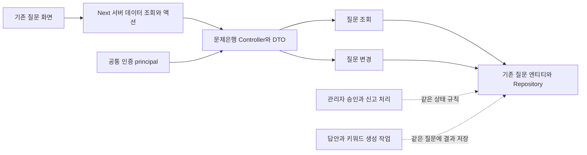
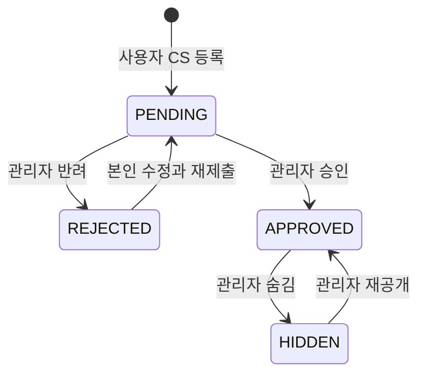

# 문제은행 백엔드 구현 청사진

WBS 3의 `problem-bank-101`부터 `problem-bank-109`까지 9개 API를 구현해 기존 질문 아카이브 화면에 연결한다. 기존 질문 엔티티를 재사용하고, 검색·페이지 조회·소유권·상태 전이·좋아요·신고 규칙을 백엔드에서 보장한다.

이 문서는 구현 전 설계 초안이다. WBS에 명시된 요구와 기존 화면의 동작을 구분하며, 아래의 응답 형식·인증 공개 범위·경계값은 구현 전에 담당자와 확정할 제안이다. 기능 코드는 이 작업에서 변경하지 않는다.

## 1. 요구사항과 범위

원본은 [최종프로젝트 4팀 WBS의 WBS 3](https://docs.google.com/spreadsheets/d/1ZcudXgHfxo-pvC2YsAEQAIcAnhHKStIwND0lUe540Ig/edit?gid=204813250#gid=204813250)이다. 문제은행은 `A14:N23`, 인증은 `auth-103`, 연계 작업은 `my-105`·`my-106`·`my-114`와 `admin-101`~`admin-109`를 참고한다.

| WBS | 메서드·경로 | 보장할 동작 |
| --- | --- | --- |
| problem-bank-101 | `GET /api/v1/learning/questions` | 공개 질문 목록, 검색·대분류·카테고리·좋아요 필터, 정렬, 서버 페이지 조회, 전체 건수·대분류 건수 |
| problem-bank-102 | `GET /api/v1/learning/questions/{questionId}` | 공개 질문 상세 또는 본인의 미승인 USER 질문 상세, 답안·키워드·개인별 상태·수정/삭제 가능 여부 |
| problem-bank-103 | `POST /api/v1/learning/questions/{questionId}/likes` | 인증 회원의 공개 질문 좋아요 등록, 변경 후 건수·선택 상태 |
| problem-bank-104 | `DELETE /api/v1/learning/questions/{questionId}/likes` | 본인의 좋아요 취소, 변경 후 건수·선택 상태 |
| problem-bank-105 | `GET /api/v1/categories` | CS/인성 대분류, 카테고리 ID·이름·표시 순서·공개 질문 수 |
| problem-bank-106 | `POST /api/v1/learning/questions` | 사용자 CS 질문을 본인 소유의 `USER/PENDING`으로 등록하고 생성 ID 반환 |
| problem-bank-107 | `PATCH /api/v1/learning/questions/{questionId}` | 본인 `PENDING/REJECTED` CS 질문 수정, 반려 질문은 검토 정보 초기화 후 재제출 |
| problem-bank-108 | `DELETE /api/v1/learning/questions/{questionId}` | 본인 `PENDING/REJECTED` 질문의 `deleted_at` 반영 |
| problem-bank-109 | `POST /api/v1/learning/questions/{questionId}/reports` | 공개 질문 신고, 필수 5유형 사유와 선택 상세 사유 검증 |

### 다른 작업과의 연결

- 관리자 등록·수정·승인·반려·숨김·신고 처리는 관리자 WBS의 별도 작업이다. 이번 9개 API가 해당 엔드포인트를 대신 구현하지 않는다.
- 승인 후 AI 답안 생성은 관리자·AI 담당 작업이다. 질문 ID, 답안 상태, 답안 본문과 키워드를 같은 질문에 기록하는 계약을 공유한다.
- 내가 올린 질문 목록은 `my-114`, 좋아요한 질문 목록과 대시보드 집계는 `my-106`·`my-105`와 연결한다. 문제은행의 공개 목록에 본인 미승인 질문을 섞지 않는다.
- 면접에서 생성된 질문의 개인 좋아요는 별도 관계다. 문제은행의 `question_likes`와 합치지 않는다.
- 프론트 URL은 현재 `/archive`와 `/archive/{id}`를 유지한다. WBS에 적힌 `/study/questions`로 화면 URL을 옮기는 작업은 이번 연결에 포함하지 않는다.

## 2. 현재 기반과 연결 차이

최신 `origin/develop`의 엔티티 작업까지 확인한 결과다.

| 영역 | 확인한 기반 | 필요한 작업 |
| --- | --- | --- |
| 백엔드 | Java 21, Spring Boot 4.2.0, JPA·Validation·WebMVC, H2 | Repository, 조회/변경 로직, Controller, 요청/응답 DTO |
| 질문 데이터 | `Question`, `Category`, `QuestionKeyword`, `QuestionLike`, `QuestionReport`, `QuestionModeration` | 기존 모델 활용, 필요한 불변식·경합 처리 보강 |
| 공통 기반 | 인증 처리·전역 업무 오류 형식·DB migration은 아직 없음 | 인증 담당과 principal 계약, 공통 오류 응답, DB 실행 정책 합의 |
| 프론트 통신 | Next 서버가 Bearer 토큰을 붙여 `BACKEND_URL` 호출 | WBS 경로·메서드·DTO에 맞춘 adapter 연결 |
| 프론트 목록/상세 | 전체 배열을 받아 검색·집계·7개 페이지 조회·상세 탐색 | 서버 페이지 응답과 전용 상세 조회를 사용하도록 데이터 조회부 전환 |

주요 근거: [빌드 설정](../../../backend/build.gradle), [질문 엔티티](../../../backend/src/main/java/com/likelion/answerfit/question/entity/Question.java), [현재 프론트 호출](../../../frontend/features/question/api.ts), [화면 자료형](../../../frontend/features/question/types.ts), [목록 데이터 조립](../../../frontend/app/(site)/archive/page.tsx), [상세 데이터 조립](../../../frontend/app/(site)/archive/[id]/page.tsx).

현재 프론트의 `/api/questions`, `PUT /{id}`, `PUT /{id}/like`는 임시 계약이다. WBS의 `/api/v1/learning/questions`, `PATCH /{id}`, `POST /{id}/likes`에 맞춘다. 화면 배치와 스타일은 유지할 수 있지만 경로 문자열만 바꿔서는 서버 페이지 조회나 반려 상태를 연결할 수 없다.

## 3. 모듈과 책임



- `question/entity`: 현재 모델과 상태 전이를 유지한다. 소유권을 HTTP 요청 값에서 받지 않는다.
- `question/repository`: 공개 조건·검색·정렬·집계·개인별 좋아요/신고 여부 조회를 담당한다.
- `question/service`: 조회와 변경을 구분한다. 변경 트랜잭션 안에서 소유권·현재 상태·카테고리를 검사하고 기존 엔티티 메서드를 호출한다.
- `question/controller`와 DTO: WBS 경로, 입력 검사, 응답 투영을 담당한다. JPA 엔티티를 직접 JSON으로 노출하지 않는다.
- 공통 인증과 업무 오류는 다른 도메인도 쓸 수 있게 공유한다. 구현이 하나뿐인 로직에 불필요한 interface/implementation 쌍을 만들지 않는다.

조회·변경·카테고리의 공개 판정은 한 규칙으로 모은다. 목록, 상세, 집계, 좋아요, 신고에서 같은 질문이 서로 다르게 공개되지 않도록 한다.

## 4. 데이터와 상태 규칙

### 기존 데이터 구조 재사용

| 모델 | 이번 작업에서의 역할 |
| --- | --- |
| `categories` | `major`, `name`, `sort_order`로 분류와 표시 순서 제공 |
| `questions` | 분류·내용·출처·작성자·승인/검토·답안 생성 상태와 soft delete |
| `question_keywords` | 질문별 키워드와 순서 보존 |
| `question_likes` | `(user_id, question_id)` 복합 PK로 회원별 좋아요 하나 보장 |
| `question_reports` | `(question_id, reporter_id)` 유일 제약과 신고 처리 상태 보존 |
| `question_moderations` | 반려/신고 조치 이력. 재제출할 때 과거 이력은 삭제하지 않음 |

새 질문 테이블은 만들지 않는다. 엔티티 주석에 적힌 복합 FK 등의 제약은 실제 DDL 적용 여부를 따로 확인한다. 운영 DB와 migration 방식이 정해지기 전에는 H2에서 통과한 결과를 운영 DB 검증으로 간주하지 않는다.

### 공개·소유권·변경 규칙 제안

- 공개 질문: `deleted_at IS NULL AND status=APPROVED`. 여기서 공개는 질문의 가시성이고 익명 접근 허용 여부와는 별개다.
- 승인 직후 답안이 생성 중이거나 생성에 실패해도 질문은 공개한다. 기존 화면 동작처럼 `modelAnswerStatus`와 nullable 답안으로 이를 구분한다. 면접 출제에 답안이 필요한 조건은 면접 담당이 별도로 적용한다.
- 미승인 상세: 인증된 본인의 `source=USER`이면서 `PENDING/REJECTED`인 질문만 허용한다. 타인의 미승인 질문, 숨김·삭제 질문은 상세에서 `404`로 처리한다.
- 수정·삭제: `source=USER`, `author_id=인증 회원`, `status IN (PENDING, REJECTED)`를 모두 만족해야 한다. `isMine`과 별도로 `canEdit/canDelete`를 응답한다.
- `REJECTED` 수정은 같은 ID로 `PENDING` 재제출이다. `reviewedBy/reviewedAt`을 비우고 현재 반려 안내를 해제하되 과거 `QuestionModeration`은 남긴다.
- 삭제는 `Question.delete()`로 `deleted_at`을 설정한다. 현재 `@SQLRestriction`만 있으므로 `repository.delete()`를 soft delete로 가정하지 않는다.
- 숨김·삭제는 과거 면접의 질문 스냅샷, 기존 신고와 검토 이력을 지우지 않는다.



답안 상태는 위 승인 상태와 독립적이다. 관리자 직접 작성은 `modelAnswerStatus=null`, 사용자 질문 승인 시 `PENDING`, 생성 성공 시 `DONE`, 실패 시 `FAILED`다. 위 흐름의 관리자·AI 처리는 연계 계약이며 이번 API 구현 범위가 아니다. 특히 현재 `Question`에는 재공개 메서드가 없으므로 `HIDDEN → APPROVED`는 관리자 작업에서 추가할 전이다.

### 입력과 반복 요청

- 사용자 등록은 CS만 허용한다. 요청에서는 `categoryId/content`만 받고, `major=CS`, `source=USER`, 작성자와 초기 상태는 서버가 설정한다.
- 카테고리는 실제 존재하는 CS 분류여야 한다. 수정에서도 대분류 불일치를 허용하지 않는다.
- 질문은 trim 후 최대 200자다. 기존 화면의 최소 10자도 유지하는 안을 제안한다. 프론트와 동일하게 Unicode code point 기준을 사용한다.
- 신고 상세는 trim 후 최대 300자, 빈 값은 허용한다. DB 컬럼 길이가 500자여도 요청 제한은 300자다.
- 신고 유형은 `WRONG_QUESTION`, `WRONG_ANSWER`, `DUPLICATE`, `INAPPROPRIATE`, `ETC`를 제안한다. 현재 enum 4종에 질문 내용 오류용 `WRONG_QUESTION`을 추가하면 기존 코드를 유지하며 5유형을 구분할 수 있다.
- 본인 질문 신고는 거절한다. 기존 유일 제약에 맞춰 한 회원이 같은 질문을 다시 신고하면 `409 ALREADY_REPORTED`를 반환하는 안을 제안한다. 관리자 신고 종료 후에도 같은 회원의 재신고 허용은 별도 정책 변경이다.
- 좋아요 POST는 이미 등록되어 있어도 같은 최종 상태, DELETE는 좋아요가 없어도 취소된 최종 상태를 반환한다. 중복·동시 요청에도 한 행과 정확한 집계를 보장한다.
- 목업의 승인대기 질문 10개 제한은 WBS의 확정 요구가 아니다. 별도 합의 전에는 이 제한을 백엔드 정책으로 추가하지 않는다.

## 5. HTTP 계약 초안

### 공통 형식과 인증

- 성공 응답은 별도 envelope 없이 JSON 객체를 반환한다. ID는 DB에서 `Long`, JSON에서는 문자열로 전달하는 안을 제안한다. 시각은 ISO 8601 UTC로 전달하고 화면 날짜는 KST로 변환한다.
- 현재 질문 화면의 로그인 요구를 유지한다. 익명 조회 허용 여부는 인증 담당과 별도 확정하며, 허용하더라도 개인화 필드와 `likedOnly`는 인증이 필요하다.
- 사용자 식별은 공통 인증에서 검증한 principal의 ID·권한·계정 상태를 사용한다. 임의의 `userId` body/query나 신뢰할 수 없는 별도 헤더로 대체하지 않는다.
- 쓰기 요청은 미인증·만료 토큰을 `401`, 이용 정지 등 접근 거절을 `403`으로 처리한다. 읽기도 전달된 잘못된 토큰을 조용히 익명으로 바꾸지 않는다.
- 오류는 프론트가 읽을 수 있는 `{code, message}`를 기본으로 하고, 필요하면 입력별 `fieldErrors`를 추가한다. 업무상 404에도 `code`를 넣어 “API 미연동”으로 오인되지 않게 한다.

```json
{
  "code": "QUESTION_NOT_FOUND",
  "message": "질문을 찾을 수 없습니다."
}
```

### 목록과 카테고리

목록 요청 예: `GET /api/v1/learning/questions?major=CS&categoryId=1&keyword=프로세스&likedOnly=false&sort=LATEST&page=1&pageSize=7`.

| 쿼리 | 제안 계약 |
| --- | --- |
| `major` | 생략 시 `CS`, `CS/PERSONALITY`만 허용 |
| `categoryId` | 생략 가능. 존재 여부와 선택 대분류 일치 검사 |
| `keyword` | trim 후 최대 100자, 질문 본문 검색. 대소문자·공백 정규화는 기존 검색 의미를 유지하고 LIKE 특수문자는 문자로 처리 |
| `likedOnly` | 기본 `false`, `true`면 현재 회원 좋아요만 조회 |
| `sort` | `LATEST`: `createdAt DESC, id DESC`; `LIKES`: `likeCount DESC, createdAt DESC, id DESC` |
| `page` | 1부터 시작. 음수·0·비정수는 `400` |
| `pageSize` | 기본 7, 1~100의 정수. 화면에서 요청한 유효한 크기를 그대로 적용 |

응답 필드는 `items`, `totalCount`, `page`, `pageSize`, `totalPages`, `majorCounts`다. `items`에는 `id/major/category/content/status/likeCount/isLiked/isMine/isReported`를 포함한다. 목록에는 답안 본문·키워드 전체를 싣지 않는다.

`totalCount`는 모든 검색·분류·좋아요 조건을 적용한 건수다. 현재 화면처럼 탭 건수는 필터와 무관한 공개 전체 건수로 유지한다. 따라서 `majorCounts`는 전체 공개 질문의 CS/인성별 건수이고, 카테고리 API의 `questionCount`도 해당 카테고리 전체 공개 건수다. 필터에 따라 건수가 바뀌는 정책으로 바꾸려면 이 의미부터 함께 변경한다.

요청 페이지가 마지막 페이지를 넘으면 마지막 유효 페이지로 보정해 실제 `page`를 반환하는 안을 제안한다. 결과가 없으면 `items=[]`, `totalCount=0`, `page=1`, `totalPages=1`로 현재 페이지 UI와 맞춘다. 페이지 사이에 데이터가 변경되면 offset 방식상 순서가 달라질 수 있으며, 동점 정렬에는 ID를 사용한다.

카테고리 응답은 `majors:[{major,name,questionCount,categories:[{id,name,sortOrder,questionCount}]}]`로 제안한다. 질문이 0개인 카테고리도 반환하며 `sortOrder,id` 순서로 정렬한다. CS 6개 카테고리와 인성 분류의 초기 값·ID는 관리자/면접 담당과 공유하고 DB seed로 관리한다.

### 상세

`GET /api/v1/learning/questions/{questionId}`는 목록 포함 여부와 무관하게 질문을 직접 조회한다. 다음 값을 반환한다.

- 기본: `id`, `major`, `category`(`id/name`, 없으면 `null`), `content`, `source`, `status`, `createdAt`, `reviewedAt`.
- 개인화: `likeCount`, `isLiked`, `isMine`, `isReported`, `canEdit`, `canDelete`, `canReport`.
- 학습: `modelAnswer`(문자열 또는 `null`), `modelAnswerStatus`, `keywords`(순서대로, 없으면 빈 배열).
- 반려: 현재 `REJECTED`일 때 본인에게 보여 줄 `rejectionReason`. 재제출 후에는 `null`이며 이전 조치 이력은 남는다.
- 앞뒤 이동: `previous/next`에 같은 대분류·카테고리의 공개 질문 `id/content`, 없으면 `null`. 기본 최신순을 사용하며 미승인 상세에서는 둘 다 `null`로 반환한다.

승인 상태와 답안 상태를 함께 제공해 미승인·생성 중·생성 실패·답안 존재를 구별한다. 상세 GET은 AI 생성이나 재생성을 실행하지 않는다.

### 등록·수정·삭제·좋아요·신고

| 작업 | 요청 | 성공 응답 제안 |
| --- | --- | --- |
| 질문 등록 | `{categoryId, content}` | `201`, `Location` 헤더와 `{id,status:"PENDING"}` |
| 질문 수정 | 변경할 `categoryId/content` 중 하나 이상. 최종 상태의 분류·내용 검증 | `200`, `{id,status,canEdit,canDelete}` |
| 질문 삭제 | 본문 없음 | `204`, 이후 상세는 `404` |
| 좋아요 등록/취소 | 본문 없음 | `200`, `{likeCount,isLiked}` |
| 신고 등록 | `{reasonType,detail}` | `201`, `{id,status:"PENDING"}` |

등록·신고 POST는 생성 요청이므로 무조건 자동 재시도하지 않는다. 질문 생성의 중복 방지 키가 필요하면 별도 계약으로 추가한다. 좋아요는 반복 가능한 상태 설정으로 처리한다. 이미 삭제된 질문의 DELETE는 `404`여도 데이터 상태는 그대로다.

### 오류 구분 제안

| HTTP | 예시 code | 의미 |
| --- | --- | --- |
| 400 | `INVALID_REQUEST`, `INVALID_CATEGORY`, `INVALID_REPORT_REASON` | 입력·페이지·enum·분류 검증 실패 |
| 401 | `UNAUTHENTICATED` | 인증이 없거나 토큰이 유효하지 않음 |
| 403 | `ACCESS_DENIED`, `SELF_REPORT_NOT_ALLOWED` | 계정/권한 거절 또는 본인 질문 신고 |
| 404 | `QUESTION_NOT_FOUND` | 없음·삭제·숨김·접근할 수 없는 미승인 질문 |
| 409 | `QUESTION_NOT_EDITABLE`, `ALREADY_REPORTED`, `QUESTION_STATE_CHANGED` | 승인 등으로 변경 불가, 중복 신고, 경합 중 상태 변경 |

상세를 볼 수 있는 본인의 승인 질문 수정/삭제는 `409`, 타인의 미승인 질문 접근은 `404`로 구분한다. DB 유일 제약 충돌을 그대로 `500`으로 내보내지 않는다.

## 6. 기존 프론트 연결 계획

연결을 위한 데이터 처리 변경은 필요하다. 새로운 화면 디자인을 만드는 작업은 포함하지 않는다.

| 연결 지점 | 필요한 변경 |
| --- | --- |
| `features/question/api.ts` | WBS 경로·메서드로 전환. 목록과 상세를 분리하고 쿼리를 전달. 전체 배열에서 질문을 찾는 사전 권한 검사를 서버 결과에 맞춤 |
| `features/question/types.ts`와 변환 | `CS/PERSONALITY ↔ cs/personality`, `content ↔ text`, `likeCount/isLiked/isMine ↔ likes/liked/mine`, 카테고리 ID와 표시 이름 매핑 |
| `/archive` 데이터 조회부 | 서버의 `items/totalCount/page/totalPages/majorCounts` 사용. 응답에 로컬 검색·페이지 나누기를 다시 적용하지 않음 |
| `/archive/{id}` 데이터 조회부 | 전용 상세 요청과 `previous/next` 사용. 공개 목록에 없는 본인 미승인 질문도 열 수 있어야 함 |
| 반려 상태 | `REJECTED`를 독립적으로 표현하고 사유·재제출·수정/삭제 권한을 연결. 대기나 승인으로 오표시하지 않음 |
| 등록 폼·서버 액션 | 생성 ID를 버리지 않고 승인대기 상세 링크 또는 이동으로 연결 |
| 분류 선택 | 카테고리 API의 ID·이름을 사용. 한글 이름 상수만으로 저장 요청을 만들지 않음. 인성 질문의 중분류가 없으면 대분류 이름으로 표시하고 중분류 링크/칩은 생략 |
| 신고 폼 | 기존 5개 문구와 `reasonType`을 일대일 매핑. 중복/본인 신고 실패 안내 |
| 모범답안 표시 | 기존 목업과 같이 첫 문단을 `summary`, 나머지를 `body`로 변환하고 키워드 연결. 저장되지 않은 비교표를 만들지 않음 |

반려 안내와 답안 생성 실패의 정확한 구분에는 기존 컴포넌트의 조건부 표시 보강이 필요하다. 이 변경도 스타일 재설계가 아닌 실제 상태 연결로 다룬다.

### 전체 배열을 공유하는 화면의 회귀 방지

현재 `getQuestions()`는 아카이브뿐 아니라 `/my/questions`, `/my/likes`, `/my` 대시보드도 사용한다. 이 함수를 공개 질문 첫 페이지로 단순 교체하면 본인 미승인 질문·좋아요 목록·건수가 누락된다.

- `my-114`는 내 질문과 상태별 건수의 전용 계약을 사용한다. 문제은행 상세·수정·삭제는 이번 계약을 재사용한다.
- `my-106`·`my-105`는 좋아요 목록과 전체 건수를 제공한다. 공개 목록 첫 페이지를 세어 대체하지 않는다.
- 회원 담당이 이 API들을 연결하기 전까지 해당 화면 전체의 백엔드 연결 완료로 보고하지 않는다. 기존 호출자를 명시적으로 분리한 뒤 질문 데이터 접근을 바꾼다.

유사 질문은 별도 생성 API를 추가하지 않고 기존 질문 검색을 재사용한다. 현재의 “승인 CS 전체를 대상으로 한 조각 유사도”와 서버 부분 검색은 결과가 같지 않다. 초안은 등록 폼 입력에서 검색어를 추출해 검색 API의 상위 후보를 안내하는 방식이다. 질문 입력은 최대 200자, 목록 검색어는 최대 100자이므로 입력 전체를 그대로 전달하지 않는다. 100자 제한을 만족하는 후보 검색어 추출·일치 기준은 구현 전에 확정한다. 현재 페이지 7개만 비교하거나 전체 아카이브를 반복 다운로드하지 않는다.

통신 경로는 브라우저 → Next 서버 액션/조회 → 백엔드다. 기존 `BACKEND_URL`과 Bearer 전달을 사용하고, 현재 경로만을 위해 브라우저 직접 호출용 CORS 구성을 추가하지 않는다.

## 7. 구현 순서와 선행 합의

| 순서 | 작업 단위 | 끝났을 때 확인할 것 |
| --- | --- | --- |
| 1 | 인증 principal·오류 형식·DB/seed 계약 확정 | 실제 토큰에서 회원 ID 확보, 세션 조회 정상, 업무 오류 구분 |
| 2 | 분류 조회와 공개 질문 Repository | 0건 분류 포함, 공개 조건, 집계·필터·정렬·페이지 일치 |
| 3 | 목록·상세 HTTP 연결 | 목록과 본인 미승인 상세 분리, 답안·키워드·앞뒤 질문 응답 |
| 4 | 사용자 CS 등록·수정·재제출·삭제 | 본인/출처/상태 검증, 검토 초기화, soft delete |
| 5 | 좋아요와 신고 | 반복 좋아요, 동시 요청, 5유형 신고, 중복·본인 신고 차단 |
| 6 | 프론트 adapter와 데이터 조회부 연결 | 개발 모드에서 검색부터 신고까지 실제 백엔드로 동작, 다른 소비자 회귀 방지 |

인증이 합쳐지기 전에도 조회·변경 로직과 테스트는 진행할 수 있다. 다만 실제 화면 연결 검증에는 인증과 세션 조회가 필요하다. 현재 프론트 세션 조회는 `/api/members/me`를 호출하지만 WBS의 내 정보는 `/api/v1/users/me`이므로 인증/회원 담당과 경로·역할 값(`USER/ADMIN ↔ member/admin`)을 맞춰야 한다.

목록 조회는 페이지 ID/기본 정보와 집계를 분리해 키워드 컬렉션 fetch join으로 페이지가 깨지는 일을 피한다. 좋아요·신고 여부는 페이지 대상 ID를 묶어 조회해 N+1을 피하고, 좋아요 수는 관계를 기준으로 집계한다. 초기에는 별도 캐시 카운터를 만들지 않는다.

사용자 수정/삭제와 관리자 승인 사이의 경합은 구현 시 같은 질문 행에 대한 트랜잭션과 잠금 규칙으로 처리한다. 초안은 질문 변경 때 행 잠금 후 현재 상태를 다시 검사하는 방식이다. 공개 상태에 의존하는 좋아요·신고와 관리자 숨김·삭제에도 같은 규칙을 적용해 검사 직후 비공개로 바뀐 질문에 새 관계가 기록되지 않도록 한다. 관리자 담당도 같은 잠금 규칙을 적용해야 한다. 현재 `Question`에 `@Version`이 있으리라 가정하지 않는다. 좋아요·신고의 중복 요청도 유일 제약과 트랜잭션 결과를 함께 검증한다.

### 구현 전에 확정할 항목

1. **공통 인증과 회원 연결**: principal 계약, 세션 API, 실제 토큰 발급/검증 경로, 읽기 API의 익명 허용 범위.
2. **DB 실행 정책**: 운영 DB, migration 담당, 공유 카테고리 seed와 FK/인덱스 적용 방식.
3. **정책 초안**: 승인 직후 공개, 최소 10자, 중복 신고 불가, 페이지 상한 100 및 범위 초과 보정에 대한 팀 확인.
4. **화면 연결 범위**: 반려/실패 표시와 생성 후 상세 연결, 내 질문·좋아요 API 담당과 연결 순서, 유사 질문 후보 검색 방식.

## 8. 검증 시나리오

번호는 후속 구현 이슈에서 연결할 수 있는 청사진 시나리오다. 아직 없는 GitHub 이슈 번호를 만들지 않는다.

| 번호 | 시나리오 | 검증할 결과 |
| --- | --- | --- |
| S1 | 공개/숨김/삭제/미승인 질문이 함께 존재 | 공개 목록·집계에는 공개 질문만 포함. 생성 중/실패 상태는 구분 |
| S2 | 대분류·카테고리·검색·좋아요·정렬·페이지 조합 | 건수와 items 일치, 동점 순서 안정, pageSize 적용, 빈 결과/범위 초과 처리 |
| S3 | 본인·다른 회원으로 미승인 상세 요청 | 본인 USER 대기/반려만 허용, 타인은 404 |
| S4 | CS 등록과 입력 경계값 | 분류 불일치·공백·길이 위반 차단, 200자와 이모지 기준 일치, 작성자/상태 위조 불가 |
| S5 | 본인 대기/반려 수정과 재제출 | ID 유지, 반려 → 대기, 현재 검토 정보 초기화, 과거 이력 보존 |
| S6 | 타인/승인 질문 수정·삭제와 승인 경합 | 승인 후 변경 차단, 권한 거절, 상태 덮어쓰기 방지 |
| S7 | 미승인 질문 삭제 후 재조회 | deleted_at 반영, 404, 과거 면접·신고·검토 기록 보존 |
| S8 | 좋아요 반복·동시 등록/취소, 다른 회원 조회 | 복합 PK 중복 없음, 실제 건수와 개인 선택 상태 일치, 미승인/숨김/삭제 질문 거절 |
| S9 | 5유형 신고·빈 상세·300/301자·중복·본인 신고 | 검증 결과와 오류 code 일치, 신고 PENDING 저장, 유일 제약 충돌을 500으로 노출하지 않음 |
| S10 | 분류 0건·관리자 승인·답안 생성 성공/실패 | 분류 유지, 공개 시점·nullable 답안·키워드 순서·상태 안내 일치 |
| S11 | 실제 인증과 개발 모드에서 전체 흐름 | 로그인 → 목록 → 상세 → 좋아요 → 등록 → 본인 상세 → 수정/삭제 → 신고. API 실패 시 오류 표시 |
| S12 | 서버 페이지 전환 후 다른 화면 조회 | 내 질문·좋아요·대시보드 전체 건수 누락 없음, 앞뒤 이동·유사 후보 유지 |

저장소의 [테스트 규칙](../../testing.md)을 따른다. 조회 조건과 집계는 Repository 테스트, 소유권·상태 전이·경합은 서비스 테스트, 경로·인증·입력·응답·오류는 HTTP 테스트로 확인한다. 새 코드에 맞춘 권한 테스트가 있어야 하며 기존 엔티티 테스트도 유지한다.

문서만 바꾸는 이번 작업은 `git diff --check`로 검증한다. 후속 백엔드 코드 변경은 `./gradlew test`, 빌드/의존성 변경은 `./gradlew build`, 프론트 연결 변경은 규칙에 명시된 타입·lint·구조·단위 검사를 실행한다. 실제 인증·관리자·AI 연결을 거치지 않은 상태에서 전체 기능 연결 완료로 보고하지 않는다.
